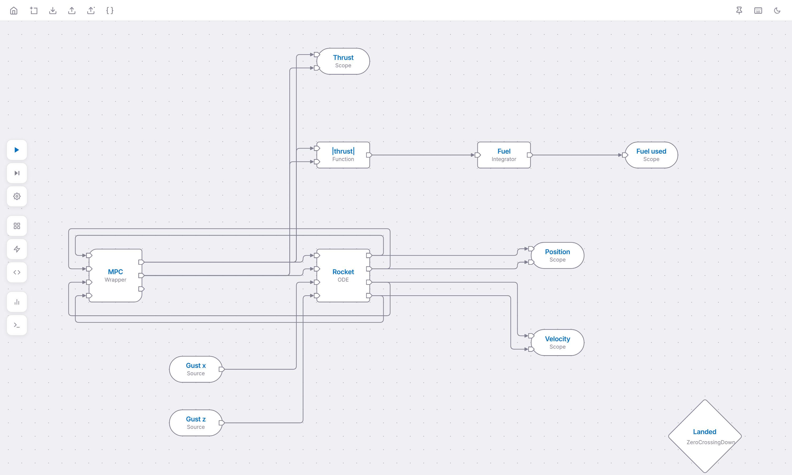
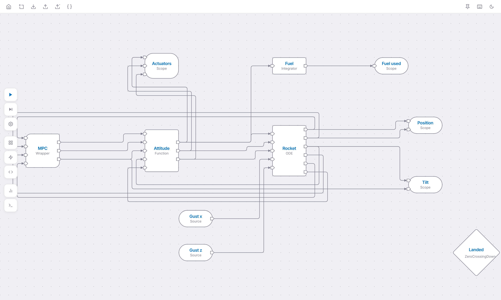
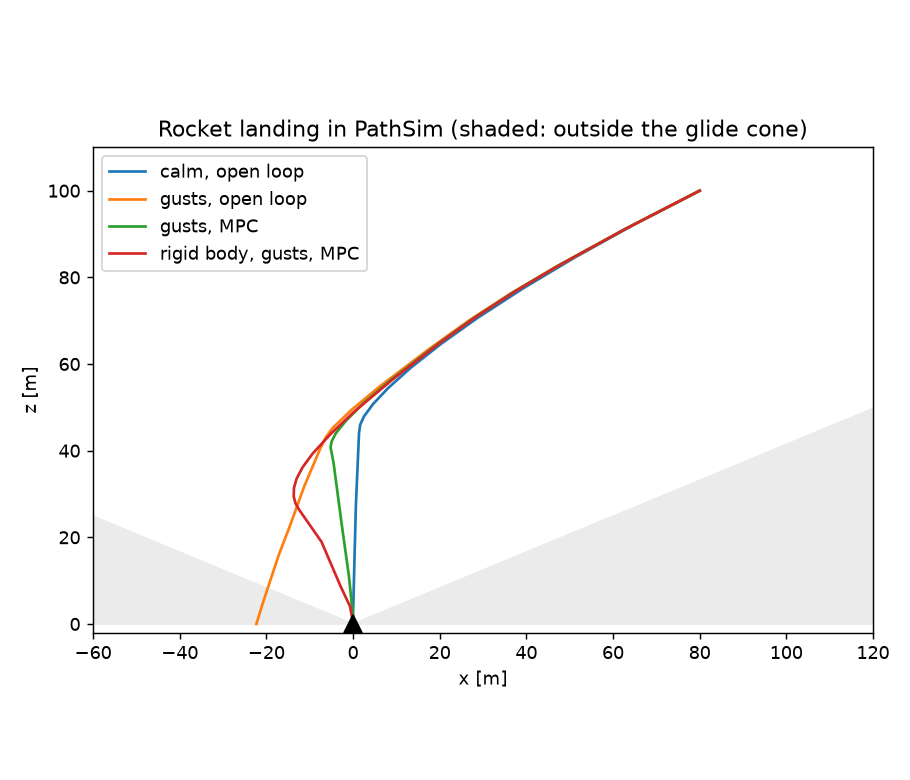

# Rocket landing in PathSim

The CVXPY × NASA 2024 (Lecture 3) minimum-fuel rocket landing problem as a PathSim block diagram: a convex planner re-solved every second (MPC) flying a rocket through wind gusts, plus a planar rigid-body extension with an inner attitude loop.

## Quick start

```bash
python3 -m venv .venv
source .venv/bin/activate
pip install -r requirements.txt

# Run all simulation cases and save plots + check numbers to out/
python3 rocket_landing.py

# Launch the interactive PathView block-diagram editor at http://127.0.0.1:5000
pathview serve
```

In the PathView editor, open `rocket_point_mass.pvm` or `rocket_rigid_body.pvm` with the open-file button in the top bar, then press **Run** (`Ctrl+Enter`). The code panel (`{ }`) holds the model's functions and a short **MODEL SETUP** block at the end. Change `MODE = "open_loop"` there to fly the plan blind.

Use the local server (`pathview serve`), not `view.pathsim.org`. The planner needs CVXPY + Clarabel, which the local server takes from your Python environment. The browser-only version runs on Pyodide, where they may not be available (untested).

## Files

| File | What it is |
| --- | --- |
| `rocket_core.py` | The plain functions: convex planner (CVXPY + Clarabel), plants, attitude loop, gust table |
| `rocket_blocks.py` | Custom PathSim blocks with named ports: `PointMassRocket`, `RigidRocket`, `LandingMPC`, `AttitudeLoop`, `GustTable` |
| `rocket_landing.py` | Builds and runs all cases with the custom blocks; prints the check numbers, saves `out/trajectories.png` |
| `make_pvm.py` | Writes the two `.pvm` files from `rocket_core.py` (re-run after editing it) |
| `rocket_point_mass.pvm`, `rocket_rigid_body.pvm` | PathView models |
| `out/` | Generated check numbers (`results.json`), trajectory comparison (`trajectories.png`), and block-diagram screenshots |

PathView draws only its built-in block types. Each custom block therefore appears in the editor as the built-in block it subclasses (MPC = `Wrapper`, Rocket = `ODE`, Attitude = `Function`, gusts = `Source`), and its functions live in the code panel. To get the named-port custom blocks into the editor's block library, package `rocket_blocks.py` as a PathView toolbox (see `docs/toolbox-spec.md` in the PathView repo).

## Diagrams

**Point mass** (lecture model): `MPC` (Wrapper, every 1 s, holds its output) → `Rocket` (ODE) → back to `MPC`. `Gust x/z` feed the rocket; `|thrust|` → `Fuel` integrator; a `Landed` zero-crossing event stops the run at touchdown.



**Rigid body** (planar body + attitude loop): `MPC` → `Attitude` (turn toward the planned thrust, push along the body) → `Rocket` (x, z, tilt, rates) → back to both.



## Check numbers (`python3 rocket_landing.py`)

| Case | Touchdown | Fuel | Notes |
| --- | --- | --- | --- |
| Point mass, calm, open loop | t = 35.0 s, x = 0.00 m, 0.00 m/s | 169.2 N·s | Minimum-fuel baseline |
| Point mass, gusts, open loop | crash at t = 31.9 s, x = −22.32 m, 3.0 m/s | 138.8 N·s | 22.3 m pad miss |
| Point mass, gusts, MPC | t = 35.0 s, x = 0.00 m, 0.00 m/s, 35 solves | 189.9 N·s | 0.0 m error on pad |
| Rigid body, gusts, MPC | t = 42.7 s, x = 0.07 m, 0.33 m/s, tilt 7.9° | 191.3 N·s | Planar body + attitude loop |

Both `.pvm` files were also converted with `pathview convert` and run. They give the same numbers.



## Rigid body: what was added, and its status

The rigid-body values are illustrative, not from the lecture: J = 30 kg m², reaction-control torque 6 N m, turn rate capped at 0.25 rad/s, gimbal off. The point-mass plan needed four convex additions before a body could fly it:
- **Thrust within 80° of vertical:** the point mass may push downward to speed up; a rocket cannot.
- **Within 15° of vertical for the last 2 s,** so it lands upright.
- **Slew limit:** the thrust vector may change by at most 3 N per second.
- **Plan at 90% thrust,** leaving margin for steering.

When the body falls behind and an on-time landing becomes impossible, the planner moves touchdown later one second at a time (up to 8 s). In this run it lands 7.7 s late.

The gimbal is off (`DELTA_MAX = 0`) because its side force fights the plan in this simple cascade. The sweep showed worse landings with 5–20° of gimbal. Making the plan aware of attitude, re-planning faster, or allocating torque between gimbal and reaction control are the obvious next steps.
